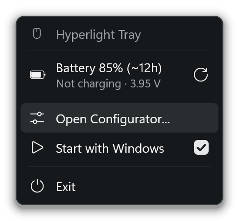
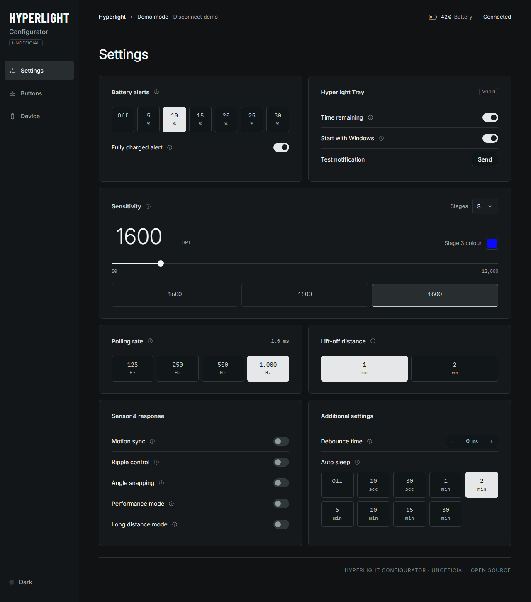

# Hyperlight Tray

An unofficial, open-source alternative to the Hitscan Utility, for the original **Hitscan Hyperlight** mouse.

---

  

- **Tray app.** The battery % sits in the taskbar. It also gives
  low-battery and fully-charged alert notifications, and estimates the time remaining.

- **Web Configurator.** A browser page for configuring various mouse options. Open it from the tray. Requires Chrome/Edge.
  
## Install

1. Download `hyperlight-tray.exe` from [Releases](https://github.com/fayewave/hyperlight-tray/releases/latest).
2. Put it somewhere permanent, e.g. `%LOCALAPPDATA%\Programs\HyperlightTray\`.
3. Run it, click the battery number in the tray, and tick **Start with Windows**.

To uninstall: untick **Start with Windows**, exit, then delete the exe and `%APPDATA%\HyperlightTray`.

## Stream Deck Plugin

Download `com.fayewave.hyperlight.streamDeckPlugin` from
[Releases](https://github.com/fayewave/hyperlight-tray/releases/latest) and open it. Then drag
**Hyperlight Tray > Mouse Battery** onto a key. It needs Stream Deck 6.5 or later, and Hyperlight Tray running.

## Privacy and safety

No driver, no admin rights and no hooks. It uses the same user-mode HID calls as the official utility. The tray's
small web server (for the configurator and the Stream Deck plugin) listens on `localhost` only, and only the
configurator page can change settings through it.

It makes two internet requests: 
- The configurator loads its fonts from Google Fonts.
- Once a day, the tray asks
GitHub's public API for the latest release. When there's a newer version, a blue dot appears on the tray number,
and the tray menu and configurator link to the release page. Nothing is downloaded or installed automatically.
Turn **Check for updates** off in the configurator to stop this request.

## License

MIT. This is an unofficial community project, not affiliated with or endorsed by Hitscan.
